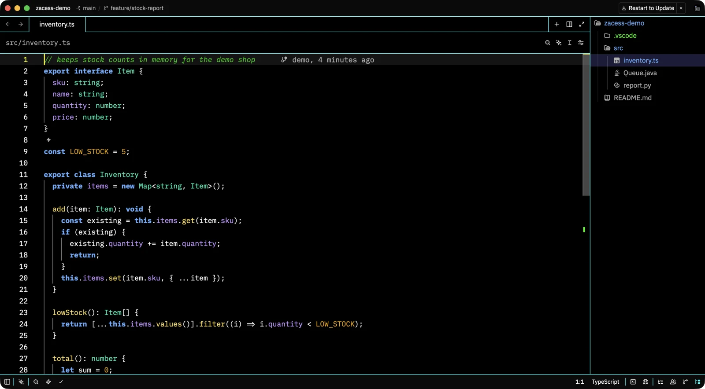
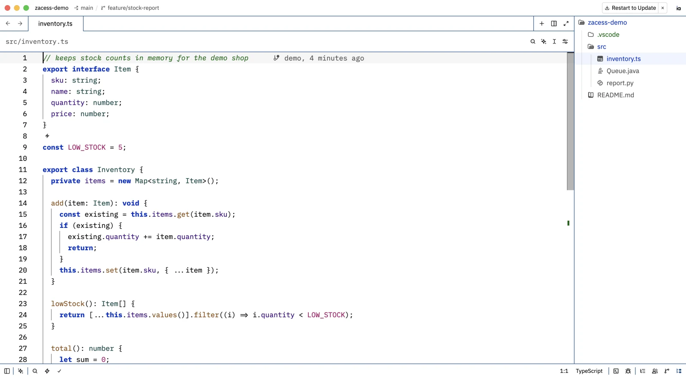
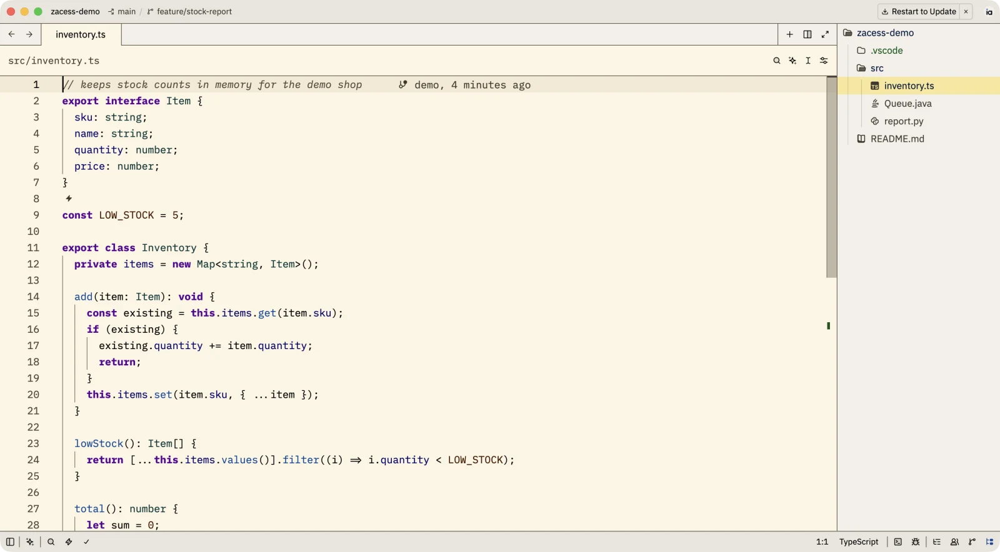
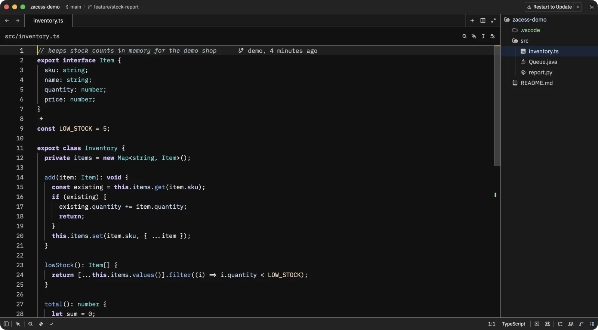
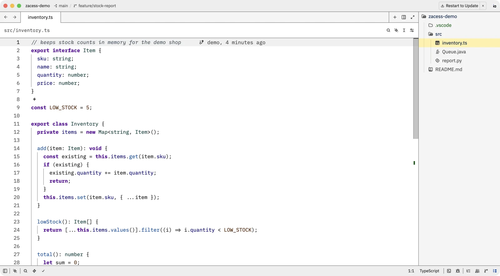
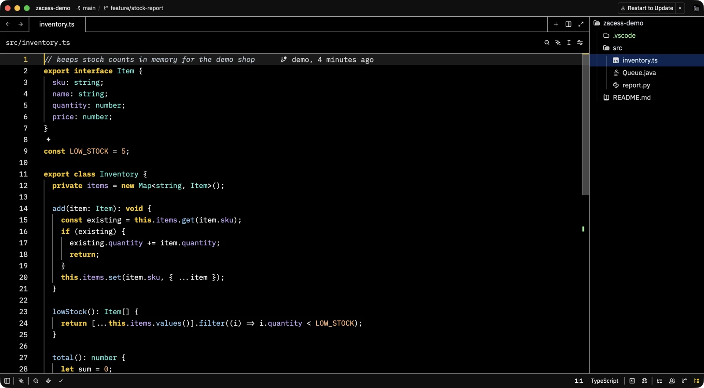
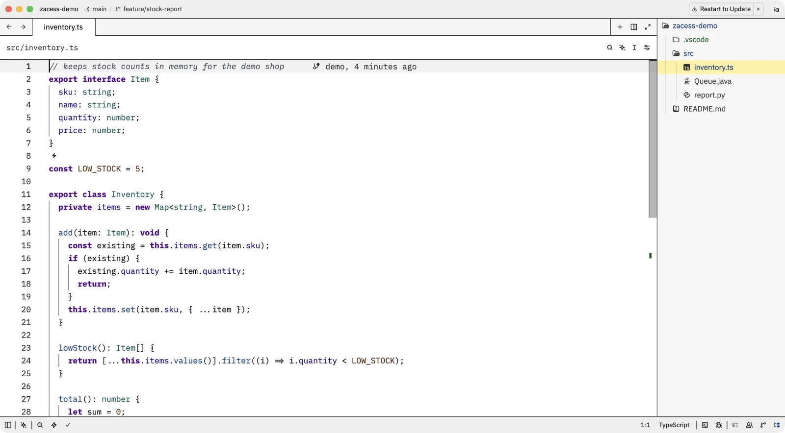

# zed-config

> Zed editor settings: the Zacess Deep Contrast Dark theme, the theme extensions it needs and setup
> guides for macOS, Linux and Windows.

## What's here

- [`settings.json`](settings.json) - interface and editor font sizes, the terminal font and the theme, fixed on
  `Zacess Deep Contrast Dark` with `Zacess Deep Contrast Light` as its light counterpart, plus
  `auto_install_extensions` so Zed installs both theme extensions on its own. Identical on every
  platform.
- [`extensions.txt`](extensions.txt) - the two theme extensions, one `id@version` per line.

## In action

Zed in each of the eight Zacess themes, with the same file open.

| Deep Contrast Dark | Deep Contrast Light |
| --- | --- |
|  |  |

| Yellow on Black | Cream |
| --- | --- |
|  |  |

| Dark | Light |
| --- | --- |
|  |  |

| High Contrast Dark | High Contrast Light |
| --- | --- |
|  |  |

The themes are from [Zacess Themes](https://github.com/zacesshq/themes).

## Setup

Full walkthrough in [guides/setup.md](guides/setup.md): copy `settings.json` into Zed's config
folder and Zed installs the extensions on its own.

> [!IMPORTANT]
> `Zacess Deep Contrast Dark` is not built into Zed. Until Zacess Themes 0.3.0 or later is
> installed, the theme does not apply.

## Structure

| Path | Contents |
| --- | --- |
| [`ACCESSIBILITY.md`](ACCESSIBILITY.md) | Measured contrast for the Deep Contrast themes and the font sizes |
| [`settings.json`](settings.json) | Installs to `~/.config/zed/` on macOS and Linux, `%APPDATA%\Zed\` on Windows |
| [`guides/`](guides/) | Setup walkthrough and settings reference |
| [`docs/demo/`](docs/demo/) | Screenshots of the editor in the Zacess themes |
